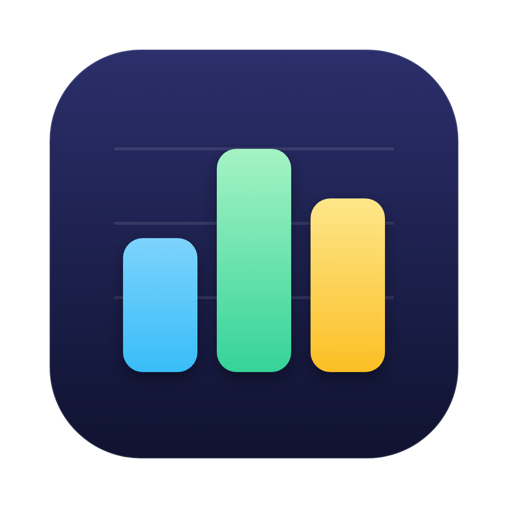
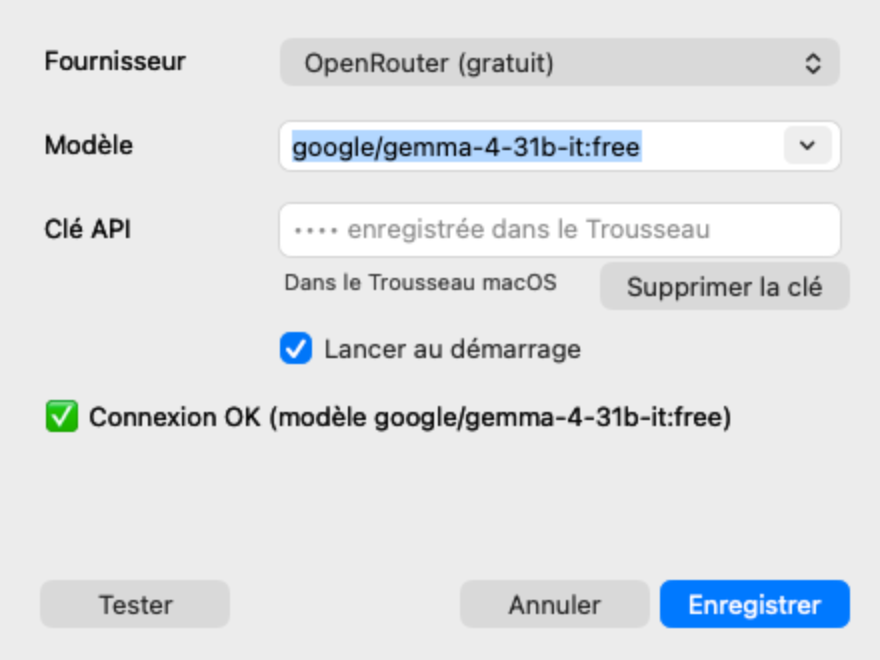

<h1 align="center">
  <br />
  Ressource Utility
</h1>

<p align="center">
  Utilitaire léger en Rust pour la barre des menus macOS : CPU, mémoire, disque et température, avec un verdict clair sur chaque processus et des conseils par IA au choix (y compris 100 % locale).
</p>

<p align="center">
  <a href="https://github.com/killerwolf/ressource-utility/actions/workflows/ci.yml"></a>
  <a href="https://github.com/killerwolf/ressource-utility/releases/latest"></a>
  <a href="LICENSE"></a>
  
</p>

<p align="center">
  
</p>

<p align="center">
  <a href="https://h4md1.fr/ressource-utility/">Site</a> ·
  <a href="https://github.com/killerwolf/ressource-utility/releases/latest">Télécharger</a> ·
  <a href="CHANGELOG.md">Changelog</a>
</p>

Le texte du bilan, tel que l'application l'écrit (sortie réelle, sans clé IA configurée) :

```text
État du Mac
⚠️ Disque presque plein : 8,9 Go libres (4 %)
✅ CPU 14 % · Mémoire 61 % · 48 °C — normal

Sécurité
✅ Aucun logiciel suspect détecté

Ce qui tourne
✅ mdworker_shared ×16 — Normal
   Spotlight (la recherche) indexe tes fichiers. Temporaire, ça se calme tout seul.
❓ WhatsApp — Inconnu
   Inconnu — configure une clé IA pour l'identifier.
👀 Google Chrome Helper ×33 — À surveiller
   Un onglet ou une extension de Google Chrome. Normal, mais beaucoup de RAM = trop d'onglets ouverts. Il utilise 2,9 Go de RAM : ferme ce qui ne sert pas.

👉 Conseil : Libère de l'espace disque (Réglages > Général > Stockage).
```

## Est-ce le bon outil ?

**Oui, si** vous voulez comprendre en une phrase pourquoi votre Mac chauffe ou ralentit, et repérer un processus inhabituel sans ouvrir le Moniteur d'activité.

**Non, si** vous cherchez un antivirus complet ou un outil multiplateforme : les contrôles de sécurité sont des heuristiques locales (noms de mineurs connus, emplacements, signature, démarrage automatique) et l'application ne fonctionne que sur macOS.

## Fonctionnalités

- Affichage `CPU · RAM · disque libre` directement dans la barre des menus
- Détection d'anomalies soutenues :
  - CPU > 85 % pendant 15 s
  - mémoire > 90 %
  - disque < 10 % ou < 10 Go libres
  - température > 90 °C
  - processus > 80 % CPU
- Bilan clair en français : un verdict par processus (✅ normal, 👀 à surveiller, 🛑 anormal, ❓ inconnu), affiché dans le menu et dans « Voir le bilan »
- Base de connaissances locale (processus système macOS, aides de navigateurs et d'apps Electron) : aucun jeton consommé pour ce qui est connu
- L'IA ne juge que les processus inconnus, avec un format de réponse strict ; le texte brut du modèle n'est jamais affiché, et les verdicts sont mis en cache à vie
- Choix du fournisseur (Anthropic, Gemini, OpenAI/Codex, OpenRouter gratuit, LM Studio local) et du modèle
- Sécurité 100 % locale (aucun jeton) : détection de mineurs de cryptomonnaie et de noms système usurpés, emplacements suspects, signature de code, audit du démarrage automatique ; 🛑 dans la barre des menus, sous-menu **Sécurité** (afficher dans le Finder, forcer à quitter avec confirmation)
- Clé API stockée dans le Trousseau macOS
- Lancement au démarrage
- Aucune icône dans le Dock

## Économie de tokens

- Aucun appel périodique au LLM.
- Un appel n'a lieu que sur demande manuelle, sur clic sur un processus, ou lorsqu'une anomalie persiste.
- Au maximum 1 appel automatique toutes les 30 minutes, et une même anomalie n'est pas réanalysée avant 2 heures.
- Prompt compact et sortie limitée à 200 tokens.

## Installation

### Depuis une release

1. Téléchargez le fichier `Ressource-Utility-<version>-macos.zip` depuis la page [Releases](../../releases) du dépôt GitHub.
2. Décompressez-le et déplacez `Ressource Utility.app` dans `~/Applications`.
3. Au premier lancement, faites un clic droit sur l'application puis choisissez **Ouvrir**. L'application est signée en ad hoc, macOS demande donc une confirmation supplémentaire.

### Depuis les sources

```sh
./scripts/bundle.sh --install
```

## Configuration

- Ouvrez le menu de la barre des menus puis :
  - **Fournisseur IA** : changement rapide entre Anthropic, Gemini, OpenAI/Codex, OpenRouter (gratuit) et LM Studio (local).
  - **Réglages…** : fenêtre native (fournisseur, modèle avec suggestions, clé API enregistrée dans le Trousseau macOS, adresse du serveur LM Studio, lancement au démarrage) avec un bouton **Tester**.
- Modèles par défaut : `claude-haiku-5-5`, `gemini-2.5-flash`, `gpt-5-mini`, `google/gemma-4-31b-it:free`, et le premier modèle chargé pour LM Studio.
- Fichier de configuration : `~/Library/Application Support/ressource-utility/config.json`

## Essayer gratuitement avec OpenRouter

1. Créez une clé sur <https://openrouter.ai/keys>.
2. Dans le menu : **Fournisseur IA** puis **OpenRouter (gratuit)**.
3. **Réglages…**, collez la clé puis **Enregistrer** (le bouton **Tester** vérifie la connexion).

Le modèle par défaut est `google/gemma-4-31b-it:free` (un ancien réglage `openrouter/free` est migré automatiquement). Vous pouvez en saisir un autre via **Réglages…**. Le palier gratuit est limité en débit : en cas d'erreur 429, réessayez plus tard.

## LM Studio (100 % local)

Lancez le serveur local dans LM Studio (onglet Developer), puis choisissez **LM Studio (local)** dans **Réglages…** : l'adresse par défaut est `http://localhost:1234/v1` et la liste des modèles est lue sur le serveur. Aucune clé n'est nécessaire.

## Mini-courbes

Les lignes CPU, mémoire et température du menu affichent une mini-courbe de la dernière heure (un point par minute, gardée en mémoire seulement).

## Confidentialité : ce qui est envoyé à l'IA

- Rien n'est envoyé tant qu'aucune clé n'est configurée, ni quand tous les processus sont connus (menu **Voir ce qui sera envoyé à l'IA** affiche le texte exact).
- Analyse : une ligne de métriques (CPU, RAM, disque, température), les alertes actives et, pour les seuls processus inconnus, `nom CPU % mémoire`.
- Processus jugé suspect localement (et qui n'est pas un mineur connu) : en plus, ses signaux (par ex. « non signé »), l'état de sa signature et son chemin, avec votre dossier personnel remplacé par `~`. Les chemins des processus normaux ne sont jamais envoyés.
- Les noms sont nettoyés (pas de retours à la ligne ni de `|`, longueur limitée). L'avis de l'IA ne peut qu'aggraver un verdict local, jamais l'adoucir. Le texte brut du modèle n'est jamais affiché.
- Avec LM Studio, tout reste sur votre Mac : rien n'est envoyé sur Internet.
- Jamais envoyés : clés, contenu de fichiers, noms d'utilisateur, historique.

## Développement

```sh
cargo run              # lance l'application dans la barre des menus
cargo run -- --dump    # affiche un instantané des métriques dans le terminal
cargo run -- --security # audit de sécurité unique (processus + démarrage automatique)
cargo test             # tests unitaires
cargo clippy           # analyse statique
```

## CI / Release

- Chaque push et pull request exécute sur GitHub Actions : `cargo fmt --check`, `cargo clippy`, `cargo test` et `cargo build --release`.
- Pour publier une version, poussez un tag `vX.Y.Z` : GitHub Actions construit le `.app` universel (Intel et Apple Silicon) et publie le zip dans une release.
